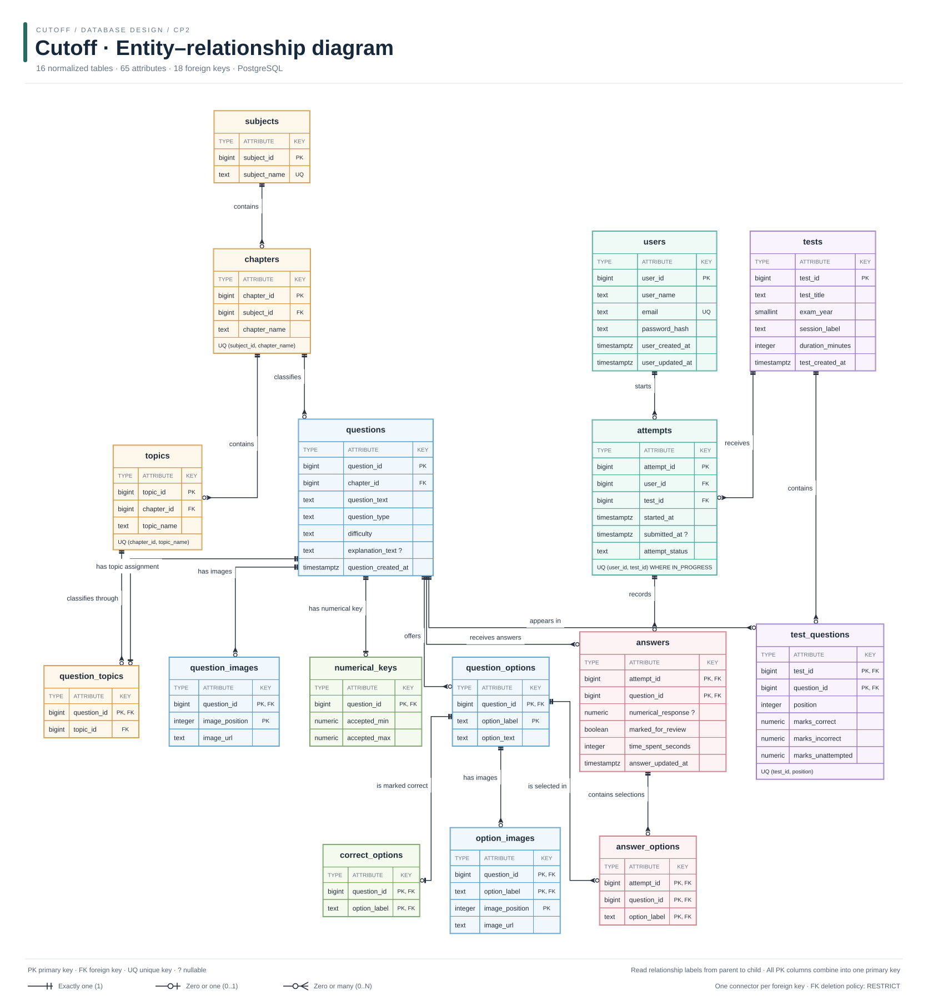

# Cutoff — AP + DE Database Project

Cutoff is a JEE Main practice platform. Students select a previous-year paper,
attempt its questions, submit their answers, and review their scores, accuracy,
time spent, and performance by subject, chapter, and topic.

This repository contains the **database coursework for Cutoff**. The application
is being developed separately in [KrishnaGulalia/cutoff](https://github.com/KrishnaGulalia/cutoff).
The MakeMyTrip assignment belongs in the separate DE repository.

## Start here

Read **[CP1: Database normalization](dbms/01_normalization.md)**.
It explains the data, shows the problems with one large table, and takes the
design through **1NF → 2NF → 3NF**, with a BCNF check at the end.

**[CP2: ER diagram and schema guide](dbms/02_schema_guide.md)** contains the full
diagram, setup instructions, and validation results. Open the
[zoomable ER diagram](dbms/02_er_diagram.svg) or the
[PostgreSQL schema](dbms/03_schema.sql) directly.
The [GitHub-renderable Mermaid version](dbms/02_er_diagram.md) includes the same
named relationships, attributes, and keys.



The design supports:

- Student accounts and login.
- Historical papers and reusable questions.
- Single-choice, multiple-select, and numerical answers.
- Multiple attempts by the same student on the same paper.
- Saving answers, marking questions for review, and tracking time.
- Server-side scoring and subject/chapter/topic analysis.

## How the database fits the application

```text
React interface → Express backend → Prisma ORM → PostgreSQL
```

The backend manages authentication, saves attempts, and calculates results.
Correct answers are excluded from question-delivery responses during a test.

CP1 defines the relational model, its business rules, keys, dependencies, and
integrity constraints. It ends with plain-language explanations of the main
design choices. The same model forms the basis of the ER diagram and SQL schema.

## AP checkpoint progress

| Checkpoint | Due date (2026) | Required file | Current content |
|---|---|---|---|
| CP1 | 16 November | `dbms/01_normalization.md` | Written: tables, keys, dependencies, 1NF, 2NF, 3NF, and BCNF discussion |
| CP2 | 17 November | `dbms/02_er_diagram.*`, `dbms/03_schema.sql` | Written and validated: ER diagram, all 16 tables, keys, constraints, and response guards |
| CP3 | 19 November | `dbms/04_queries.sql` | Existing file contains MakeMyTrip queries; must be replaced with Cutoff queries |
| CP4 | 23 November | `dbms/05_query_timings.md`, `dbms/plans/` | Timing file is empty; plans have not been added |

The tracker checks files with real content on the repository's **default branch**.
Writing a file locally does not submit it. Every team member must also have their
own commits. The table above describes the files, not a confirmed tracker result.

## Repository contents

```text
CutOff_AP_2026/
├── README.md
└── dbms/
    ├── 01_normalization.md    # CP1: Cutoff database design
    ├── 02_er_diagram.svg      # CP2: zoomable diagram
    ├── 02_er_diagram.png      # CP2: high-resolution image
    ├── 02_er_diagram.md       # GitHub-renderable diagram with named relationships
    ├── 02_er_diagram.mmd      # Editable Mermaid source
    ├── 03_schema.sql          # CP2: PostgreSQL DDL and integrity triggers
    ├── 04_queries.sql        
    ├── 05_query_timings.md   
```
