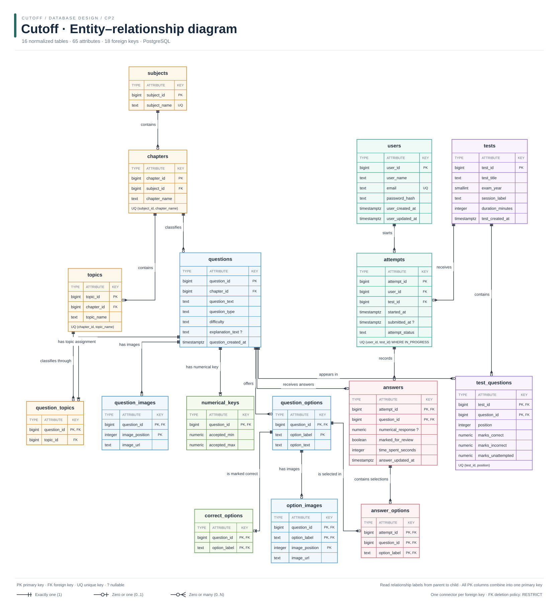
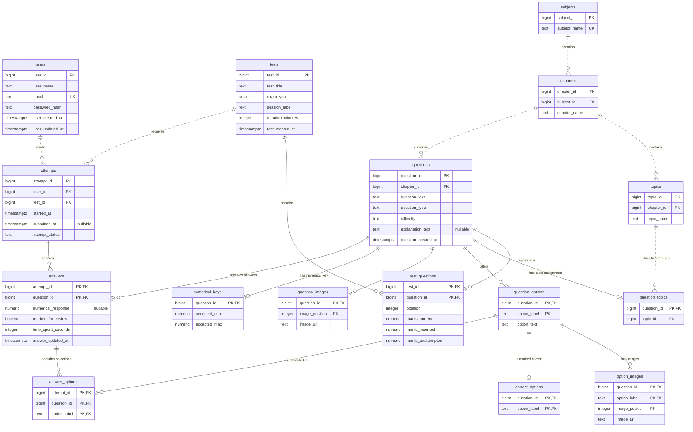

# Cutoff — Entity–Relationship Diagram

The main diagram groups the 16 tables into **classification**, **question bank**,
**papers**, and **student activity**. It matches the 65 columns and 18 foreign
keys in [03_schema.sql](03_schema.sql).

Open the [zoomable SVG](02_er_diagram.svg), [high-resolution PNG](02_er_diagram.png),
or [editable Draw.io source](02_er_diagram.drawio).

Connector labels identify the foreign-key columns. Crow's-foot symbols show
whether a relationship allows exactly one, zero or one, or zero or many rows.
`PK` and `FK` mark every participating column, including composite keys.
`UQ` marks unique constraints; composite sets are written below their tables.
`UQ*` marks the rule allowing only one active attempt per student and paper.
Only columns marked `NULL` are nullable.

Edit the `.drawio` file and export both SVG and PNG when changing the main diagram.
Keep the SQL schema and the Mermaid source below consistent with those changes.

## Mermaid version with named relationships

This alternate view labels relationships with verbs such as “starts”, “contains”,
and “records”. Its editable source is [02_er_diagram.mmd](02_er_diagram.mmd).

`PK` = primary key; `FK` = foreign key; `UK` = unique key.
All PK-marked columns form one composite primary key where applicable.
Solid lines identify relationships whose FK columns form part of the child PK;
dashed lines identify the other relationships.

Composite unique constraints: `chapters(subject_id, chapter_name)`,
`topics(chapter_id, topic_name)`, and `test_questions(test_id, position)`.
`attempts(user_id, test_id)` is unique only while `attempt_status = IN_PROGRESS`.

